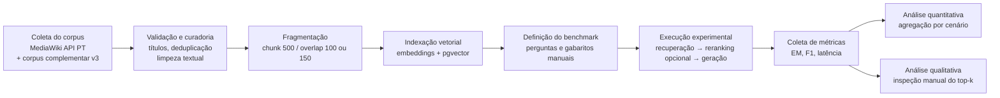
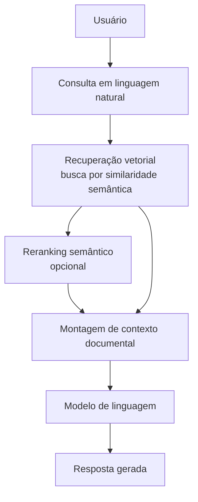
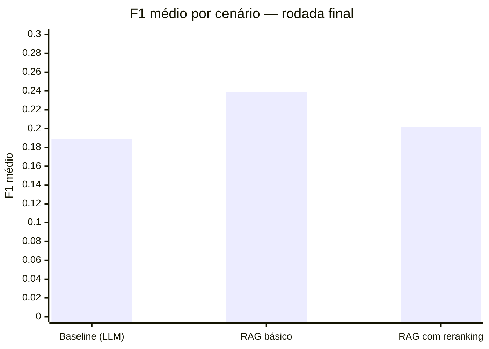
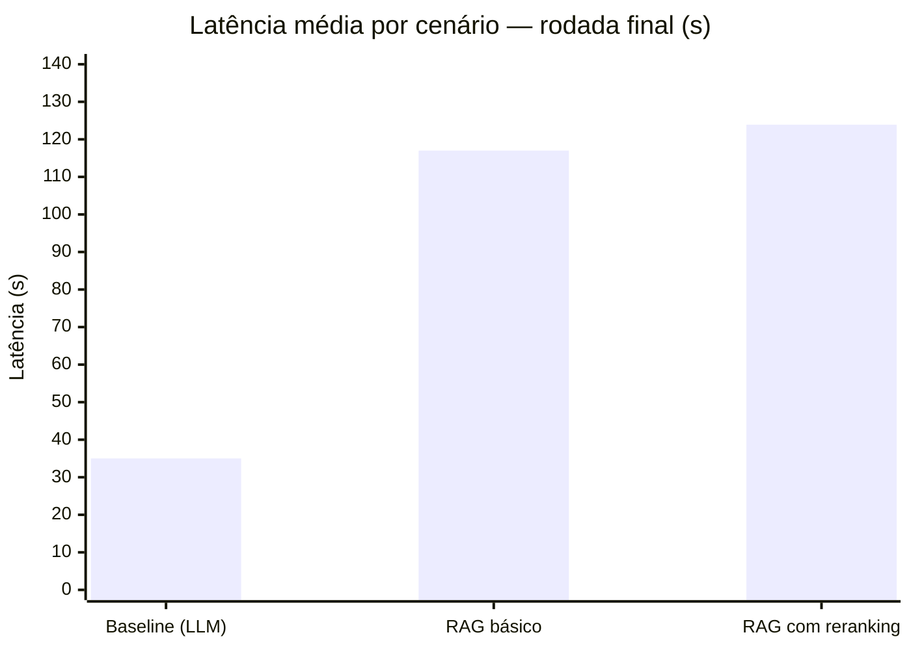
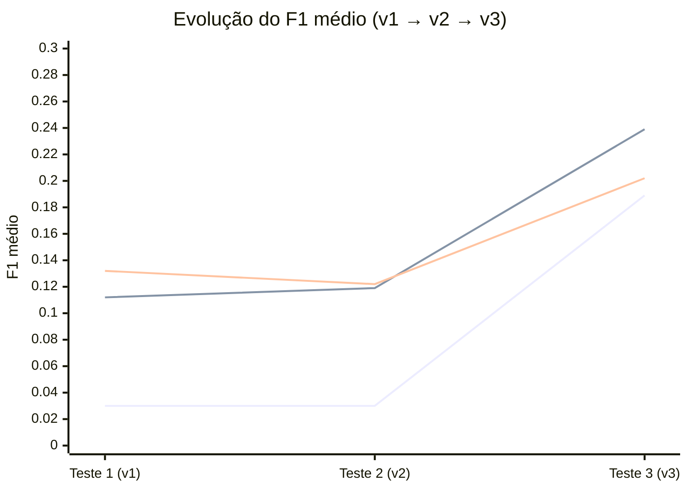

Arquitetura de Referência e Avaliação de Sistemas de Consulta Documental com Retrieval-Augmented Generation

Letícia Ferreira dos Santos Zullo¹; Lucas José de Souza2

1 Engenheira da Computação. Universidade Tecnológica Federal do Paraná. E-mail: leticiazullo@gmail.com
2 Doutor. Universidade Federal do Paraná. E-mail: souza.lucasj@gmail.com

 
Arquitetura de Referência e Avaliação de Sistemas de Consulta Documental com Retrieval-Augmented Generation
Resumo 
Os modelos de linguagem de grande escala (Large Language Models – LLMs) apresentam limitações relacionadas à atualização do conhecimento e à confiabilidade das respostas geradas. Nesse contexto, a técnica Retrieval-Augmented Generation (RAG) tem sido utilizada para incorporar informações recuperadas de fontes externas ao processo de geração textual. Este trabalho teve como objetivo propor e avaliar uma arquitetura de referência para sistemas de consulta documental em português baseada em recuperação vetorial e geração de respostas por modelos de linguagem. Foi desenvolvido um pipeline utilizando embeddings semânticos, armazenamento vetorial em PostgreSQL com pgvector e geração local por meio do modelo phi3. A avaliação foi realizada por meio de três rodadas sucessivas de testes, comparando um cenário sem recuperação contextual, um cenário com recuperação vetorial e um cenário com recuperação vetorial associada a reranking. Os resultados demonstraram que a recuperação contextual contribuiu para melhorar a aderência das respostas em relação ao modelo isolado, enquanto a etapa de reranking não apresentou ganhos proporcionais frente ao aumento de latência observado. Os experimentos também evidenciaram a influência da cobertura documental sobre o desempenho do sistema. Conclui-se que a arquitetura proposta apresenta viabilidade técnica para aplicações de consulta documental em português, destacando a importância da qualidade do corpus e da estratégia de recuperação adotada para a obtenção de respostas mais relevantes.
Palavras-chave: Modelos de Linguagem; Recuperação da Informação; Busca Semântica; Processamento de Linguagem Natural; Engenharia de Software.

Introdução
Nos últimos anos, o avanço da inteligência artificial tem impulsionado o desenvolvimento de sistemas capazes de compreender e gerar linguagem natural em larga escala. Nesse contexto, os modelos de linguagem de grande escala "Large Language Models" [LLMs] têm se destacado por sua capacidade de realizar tarefas como geração de texto, resposta a perguntas e interpretação de linguagem, sendo amplamente aplicados em assistentes virtuais, sistemas de apoio à decisão e ferramentas voltadas à automação de processos baseados em conhecimento (Brown et al., 2020).
Apesar desses avanços, esses modelos apresentam limitações relevantes, especialmente em aplicações que exigem informações específicas ou fundamentadas em fontes confiáveis. Como os LLMs operam com base em padrões aprendidos durante o treinamento, podem gerar respostas imprecisas, desatualizadas ou não verificáveis, comprometendo sua utilização em cenários que demandam maior confiabilidade e rastreabilidade das informações produzidas.
Com o objetivo de mitigar essas limitações, surgiu a abordagem conhecida como "Retrieval-Augmented Generation" [RAG], que combina modelos de linguagem com mecanismos de recuperação da informação. Essa técnica permite que o sistema consulte documentos externos e utilize essas informações como contexto para a geração de respostas, aumentando a precisão e a relevância dos resultados obtidos (Lewis et al., 2020).
A utilização de RAG tem se expandido em aplicações voltadas à consulta documental, como bases de conhecimento, sistemas corporativos e repositórios de informações técnicas. Nesse contexto, o desempenho desses sistemas está diretamente relacionado às estratégias de recuperação empregadas, bem como à forma como os documentos são organizados e disponibilizados durante o processo de geração das respostas. Estudos indicam que melhorias na construção do contexto e na recuperação das informações podem impactar significativamente a qualidade do conteúdo produzido pelos modelos de linguagem (Gao et al., 2021).
Entre as estratégias utilizadas nesse tipo de solução destacam-se a recuperação vetorial baseada em embeddings semânticos, o armazenamento de representações vetoriais em bancos de dados especializados e a utilização de mecanismos complementares de refinamento, como técnicas de reranking. Entretanto, a efetividade dessas abordagens depende de fatores como a qualidade do corpus documental, a cobertura temática disponível, a estratégia de recuperação adotada e as características do modelo gerador utilizado.
Apesar da crescente adoção de sistemas baseados em RAG, ainda existem desafios relacionados à definição de arquiteturas de referência que orientem sua implementação e avaliação. A ausência de diretrizes consolidadas dificulta a padronização das soluções e a análise do impacto das diferentes estratégias de recuperação sobre a qualidade das respostas produzidas, especialmente sob a perspectiva da Engenharia de Software.
Diante desse contexto, o objetivo deste trabalho foi propor e avaliar uma arquitetura de referência para sistemas de consulta documental baseados em modelos de linguagem utilizando RAG, analisando o impacto de diferentes estratégias de recuperação da informação sobre a qualidade das respostas geradas e o desempenho do sistema.

A presente investigação justifica-se pela crescente incorporação de modelos de linguagem em sistemas de consulta documental e de apoio à decisão baseados em conhecimento. Apesar de sua versatilidade, tais modelos permanecem limitados quanto à atualização de informações, à verificabilidade das respostas produzidas e à dependência exclusiva do conhecimento internalizado durante o treinamento. A abordagem Retrieval-Augmented Generation (RAG) constitui resposta metodológica a essas limitações, ao integrar mecanismos de recuperação da informação ao processo de geração textual (Lewis et al., 2020). Todavia, persistem incertezas quanto ao efeito concreto de estratégias distintas de recuperação — notadamente a busca vetorial densa e o reranking semântico — sobre a qualidade das respostas e sobre o desempenho operacional do sistema. Neste contexto, o trabalho realiza avaliação empírica comparativa de três configurações experimentais em ambiente controlado, com corpus técnico versionado em língua portuguesa e protocolo de benchmark manual fundamentado em métricas de aderência textual e de latência.

As principais contribuições deste trabalho são: (i) a proposição de uma arquitetura de referência para sistemas de consulta documental baseados em Retrieval-Augmented Generation em língua portuguesa; (ii) a construção de um benchmark reproduzível para avaliação de estratégias de recuperação da informação; (iii) a comparação experimental entre modelos sem recuperação contextual, recuperação vetorial e recuperação vetorial com reranking; e (iv) a análise do impacto da cobertura documental e das estratégias de recuperação sobre a qualidade das respostas geradas.

Metodologia 
Esta pesquisa caracterizou-se como aplicada, pois teve como objetivo desenvolver e avaliar uma arquitetura de referência para sistemas de consulta documental baseados em modelos de linguagem. Quanto à abordagem metodológica, adotou-se um método misto, combinando análises quantitativas e qualitativas dos resultados obtidos. A abordagem quantitativa foi utilizada para mensurar o desempenho das estratégias de recuperação da informação por meio das métricas Exact Match (EM), F1 Score e indicadores de latência, enquanto a abordagem qualitativa permitiu avaliar a relevância e a diversidade dos documentos recuperados e sua influência na geração das respostas.

A definição da arquitetura de referência precedeu a coleta e o processamento dos dados experimentais, conforme sintetizado na Figura 1. O corpus documental foi constituído a partir de artigos técnicos da Wikipédia em português, obtidos por meio da API MediaWiki, abrangendo domínios relacionados a aprendizado de máquina, inteligência artificial, engenharia de software, recuperação da informação e estilo arquitetural REST, entre outros. A seleção temática obedeceu a listas controladas por versão: na primeira versão, nove títulos indexados; na segunda, expansão incremental com doze tópicos adicionais, dos quais dois foram efetivamente incorporados ao índice (+35 fragmentos); na terceira, quinze títulos submetidos a validação prévia de existência e redirecionamento de páginas. Conteúdos inferiores a duzentos caracteres foram excluídos. Complementarmente, na versão final incluiu-se material curado sobre pgvector para suprir lacunas de cobertura na Wikipédia em português.

O tratamento dos documentos compreendeu normalização textual, fragmentação sequencial (aproximadamente quinhentos caracteres, com sobreposição de cem caracteres nas versões iniciais e cento e cinquenta na versão final) e, na terceira versão, procedimentos de deduplicação por hash criptográfico, bloqueio de reindexação por título e filtragem de fragmentos com elevada similaridade textual. Após o processamento, os textos foram convertidos em representações vetoriais densas pelo modelo sentence-transformers/all-MiniLM-L6-v2 e armazenados em PostgreSQL com extensão pgvector. As perguntas de avaliação e respectivos gabaritos foram definidos manualmente, organizados nos subconjuntos core_5 e extended. Os resultados foram registrados por meio das métricas Exact Match e F1 Score, com normalização compatível ao benchmark SQuAD, além de indicadores de latência total e por etapa do pipeline. Complementarmente, procedeu-se à inspeção qualitativa manual da recuperação documental em consultas representativas do domínio avaliado.

Figura 1 – Sequência metodológica do trabalho

Fonte: Elaborado pela autora.

A arquitetura desenvolvida fundamentou-se na abordagem Retrieval-Augmented Generation (RAG) e organizou-se em camadas funcionais correspondentes à recuperação vetorial, à geração de embeddings, à montagem de contexto, à geração textual e à persistência dos registros experimentais. A implementação em Python adotou o padrão Strategy Pattern, permitindo reutilizar o mesmo fluxo de inferência em distintos cenários mediante a substituição das estratégias de recuperação e de refinamento. Entre os componentes empregados destacam-se PostgreSQL com pgvector para armazenamento vetorial, modelos sentence-transformers e cross-encoder para embeddings e reranking, respectivamente, e geração local de respostas por meio do Ollama com o modelo phi3. Essa organização permitiu a reutilização do mesmo pipeline em diferentes cenários de inferência, alterando apenas as estratégias de recuperação e refinamento utilizadas durante as avaliações.
A validação quantitativa do pipeline foi realizada por meio da execução controlada de um benchmark sobre um conjunto fixo de perguntas e gabaritos. A avaliação experimental foi conduzida por execução programática controlada do pipeline de inferência, assegurando uniformidade de condições entre cenários e entre rodadas. Embora o protótipo disponibilize interface HTTP baseada em FastAPI para operação e demonstração, os benchmarks formais não recorreram a essa camada de comunicação. A unidade de análise adotada foi o par pergunta-cenário. Em cada rodada, todos os cenários foram avaliados utilizando o mesmo conjunto de perguntas, permitindo a comparação direta entre as diferentes estratégias de recuperação.
Foram avaliados três cenários distintos. O primeiro cenário, denominado Baseline (LLM), enviou as perguntas diretamente ao modelo de linguagem, sem utilização de contexto externo. O segundo cenário, denominado RAG básico, incorporou ao prompt os fragmentos textuais recuperados semanticamente pelo mecanismo vetorial. O terceiro cenário, denominado RAG com reranking, adicionou uma etapa intermediária de reranking responsável por reordenar os candidatos inicialmente recuperados antes da geração final da resposta.
Tabela A – Cenários avaliados
Cenário	Recuperação vetorial	Reranking	Descrição
Baseline (LLM)	Não	Não	Pergunta enviada diretamente ao modelo de linguagem
RAG básico	Sim	Não	Contexto recuperado incorporado ao prompt
RAG com reranking	Sim	Sim	Recuperação em dois estágios
O corpus foi tratado como um artefato versionado ao longo do desenvolvimento do trabalho, permitindo preservar os resultados históricos das rodadas de avaliação e ampliar gradualmente a cobertura temática disponível. Foram utilizadas três versões sucessivas do corpus documental.
Tabela B – Evolução do corpus documental
Versão	Finalidade	Características principais
wikipedia_benchmark_v1	Baseline inicial	Nove tópicos indexados; fragmentos de aproximadamente 500 caracteres; overlap de 100 caracteres; cerca de 411 fragmentos
wikipedia_benchmark_v2	Expansão incremental	Inclusão de novos tópicos relacionados à recuperação semântica e expansão parcial do índice
wikipedia_benchmark_v3	Refinamento do corpus	Validação de títulos, deduplicação, corpus complementar e overlap de 150 caracteres
Na rodada final, o índice vetorial acumulado totalizou aproximadamente 601 fragmentos textuais provenientes das versões v1, v2 e v3. A estratégia cumulativa foi mantida para preservar rastreabilidade histórica e comparabilidade metodológica entre as diferentes rodadas.
Na versão v3 foram incorporados mecanismos adicionais de controle de qualidade do corpus, incluindo deduplicação por hash SHA-256, filtragem de fragmentos com elevada similaridade textual e validação prévia dos tópicos documentais antes da indexação. Também foi incorporado conteúdo complementar para temas com baixa cobertura na Wikipédia em português, especialmente relacionados à busca vetorial.
A recuperação semântica utilizou embeddings gerados pelo modelo Sentence-BERT (sentence-transformers/all-MiniLM-L6-v2), amplamente empregado em tarefas de busca semântica e recuperação baseada em similaridade textual (REIMERS; GUREVYCH, 2019). Os vetores foram armazenados em PostgreSQL utilizando a extensão pgvector, permitindo consultas por similaridade do cosseno diretamente no banco de dados relacional.
Durante a indexação da versão final foram utilizados fragmentos de aproximadamente 500 caracteres com overlap de 150 caracteres. Em cada consulta foram recuperados os cinco fragmentos semanticamente mais próximos da pergunta realizada.
No cenário com reranking foi adotada uma estratégia de recuperação em dois estágios. Inicialmente foi recuperado um conjunto ampliado de candidatos por similaridade vetorial. Em seguida, os candidatos foram reordenados utilizando o modelo cross-encoder/ms-marco-MiniLM-L-6-v2, abordagem baseada em reranking de passagens descrita por Nogueira e Cho (2019).
A geração textual foi realizada localmente por meio do Ollama utilizando o modelo phi3. Para aumentar a reprodutibilidade dos resultados foi utilizada temperatura igual a zero e controle de verbosidade por meio de instruções de resposta objetiva.
As perguntas utilizadas no benchmark foram definidas manualmente e organizadas em subconjuntos específicos. As respostas de referência também foram construídas manualmente, servindo como gabaritos para cálculo das métricas automáticas. Foram executadas três rodadas sucessivas de avaliação.
Tabela C – Rodadas de benchmark
Teste	Identificador de execução	Corpus utilizado	Número de perguntas
Teste 1	20260525_160434	wikipedia_benchmark_v1	5
Teste 2	20260526_020326	wikipedia_benchmark_v2	5
Teste 3	20260526_171347	wikipedia_benchmark_v3	18
Na rodada final foram utilizadas dezoito perguntas divididas em dois subconjuntos: core_5, composto pelas perguntas históricas utilizadas desde as primeiras avaliações, e extended, composto por perguntas adicionais relacionadas a embeddings, recuperação da informação, bancos vetoriais, reranking e pipelines RAG.
A validação quantitativa utilizou as métricas Exact Match (EM) e F1 Score em nível de token, amplamente empregadas em tarefas de perguntas e respostas e utilizadas originalmente no benchmark SQuAD (RAJPURKAR et al., 2016). O Exact Match foi utilizado para verificar a correspondência exata entre a resposta gerada e o gabarito de referência. Já o F1 Score foi utilizado como principal métrica de qualidade, medindo a sobreposição entre os tokens presentes na resposta produzida e aqueles presentes no gabarito esperado.
O processo de normalização textual incluiu conversão para letras minúsculas, remoção de pontuação e eliminação de artigos, seguindo procedimento semelhante ao utilizado no conjunto SQuAD (RAJPURKAR et al., 2016).
Além das métricas de qualidade textual, também foram registradas métricas de desempenho relacionadas à latência total do pipeline, à latência de recuperação vetorial, à latência de geração textual e ao tempo adicional introduzido pela etapa de reranking. Os indicadores foram inicialmente calculados para cada par pergunta-cenário e posteriormente agregados por média aritmética dentro de cada cenário avaliado.
Complementarmente, foi realizada avaliação qualitativa manual dos documentos recuperados. Essa análise considerou a relevância do primeiro documento retornado, a diversidade dos documentos recuperados, a ocorrência de fragmentos repetidos e a distribuição dos resultados entre as diferentes versões do corpus documental. Essa etapa complementou as métricas automáticas, uma vez que EM e F1 avaliam apenas a resposta final produzida pelo sistema e não a qualidade dos documentos utilizados como contexto.
A validação quantitativa realizada neste trabalho possui caráter descritivo e comparativo. Não foram aplicados testes estatísticos inferenciais, como testes t, ANOVA ou intervalos de confiança, em razão do tamanho reduzido da amostra e da execução única de cada configuração experimental. Dessa forma, os resultados devem ser interpretados como evidências comparativas do comportamento da arquitetura proposta, complementadas pela análise qualitativa dos documentos recuperados.
Por fim, ressalta-se que a comparação entre as diferentes rodadas deve ser realizada com cautela, uma vez que a versão final incorporou simultaneamente expansão do corpus, ampliação do conjunto de perguntas e ajustes nos mecanismos de recuperação empregados. Dessa forma, os resultados documentam a evolução incremental da arquitetura ao longo do desenvolvimento do trabalho e não apenas uma comparação isolada entre técnicas de recuperação.

Resultados e Discussão
Os resultados apresentados nesta seção referem-se à avaliação empírica da arquitetura proposta. A Figura 2 sintetiza a arquitetura de referência proposta, enfatizando o fluxo de consulta documental assistida por recuperação de informação. Inicialmente discute-se o desempenho dos cenários de recuperação; em seguida, analisam-se a evolução do corpus documental, os resultados quantitativos do benchmark e, por fim, a qualidade qualitativa dos documentos recuperados.

Figura 2 – Arquitetura de referência para consulta documental com RAG

Fonte: Elaborado pela autora.

A rodada final do benchmark, identificada pelo código de execução 20260526_171347, utilizou o corpus wikipedia_benchmark_v3, composto por aproximadamente seiscentos e um fragmentos textuais acumulados das versões v1, v2 e v3. Foram avaliadas dezoito perguntas em domínio técnico em português, distribuídas nos subconjuntos core_5 e extended, nos três cenários metodológicos: Baseline (LLM), RAG básico e RAG com reranking. A configuração experimental manteve recuperação dos cinco fragmentos mais similares (top-k = 5), pool ampliado de dez candidatos no reranking, embeddings sentence-transformers/all-MiniLM-L6-v2, reranker cross-encoder/ms-marco-MiniLM-L-6-v2 e geração local via Ollama com modelo phi3 e temperatura zero, conforme descrito na metodologia. A evolução entre as três rodadas de benchmark está detalhada na Tabela C.

A Tabela 1 apresenta os resultados médios obtidos na rodada final do benchmark. A Figura 3 complementa a análise quantitativa com a representação gráfica do F1 médio e da latência média por cenário.

Tabela 1 – Métricas médias globais da rodada final
Cenário	EM médio	F1 médio	Latência média (s)	Fragmentos médios recuperados
Baseline (LLM)	0,000	0,189	35,0	0
RAG básico	0,000	0,239	117,0	5,0
RAG com reranking	0,000	0,202	123,9	5,0

Figura 3 – F1 médio e latência média por cenário (rodada final, n = 18)

Fonte: Elaborado pela autora com base nos resultados do benchmark 20260526_171347.

Observou-se que o cenário de recuperação vetorial básica apresentou o melhor desempenho médio entre os cenários avaliados, alcançando F1 médio de 0,239. Em comparação ao cenário sem recuperação contextual, verificou-se incremento absoluto de aproximadamente 0,050 pontos na métrica F1, correspondente a um ganho relativo de aproximadamente 26,5%. Esse resultado sugere que a incorporação de contexto recuperado contribuiu positivamente para a aderência das respostas produzidas em relação aos gabaritos de referência, comportamento compatível com a proposta de sistemas baseados em Retrieval-Augmented Generation descrita por Lewis et al. (2020), na qual a recuperação de conhecimento externo complementa as limitações do conhecimento paramétrico armazenado pelo modelo de linguagem.
O Exact Match permaneceu igual a zero em todos os cenários avaliados. Considerando que a métrica exige correspondência exata entre resposta e gabarito, esse resultado foi considerado compatível com o comportamento esperado para modelos generativos, que frequentemente produzem respostas semanticamente corretas, porém diferentes da redação utilizada como referência. Situação semelhante é observada em tarefas de perguntas e respostas avaliadas por meio das métricas EM e F1 propostas por Rajpurkar et al. (2016).
A influência da cobertura documental foi analisada por meio da separação das perguntas entre os subconjuntos core_5 e extended.
Tabela 2 – F1 médio por subconjunto de perguntas
Subconjunto	Número de perguntas	Baseline (LLM)	RAG básico	RAG com reranking
core_5	5	0,282	0,332	0,294
extended	13	0,153	0,204	0,166
Os resultados obtidos no subconjunto core_5 foram superiores aos observados no subconjunto extended em todos os cenários avaliados. Esse comportamento era esperado, uma vez que as perguntas do subconjunto core_5 estavam diretamente relacionadas aos tópicos presentes desde as primeiras versões do corpus documental.
Por outro lado, o subconjunto extended concentrou perguntas relacionadas a embeddings, recuperação da informação, bancos vetoriais, reranking e pipelines RAG. Mesmo apresentando menor desempenho médio, o cenário RAG básico manteve resultados superiores ao baseline. Esse comportamento reforça a importância da recuperação contextual em tarefas de perguntas e respostas, especialmente em domínios técnicos com cobertura documental limitada, conforme discutido por Karpukhin et al. (2020).
A evolução dos resultados ao longo das diferentes versões do corpus documental é apresentada na Tabela 3. A representação gráfica dessa evolução encontra-se no Apêndice C, com as ressalvas metodológicas pertinentes.

Os resultados apresentados na Tabela 3 devem ser interpretados como evidências da evolução incremental da arquitetura ao longo do desenvolvimento do trabalho, e não como comparação direta entre experimentos estatisticamente equivalentes. As diferentes rodadas utilizaram versões distintas do corpus documental, conjuntos de perguntas com tamanhos diferentes e refinamentos sucessivos nos mecanismos de recuperação e preparação dos dados.

Tabela 3 – Evolução das métricas entre as rodadas de benchmark
Teste	Corpus	Número de perguntas	Cenário	F1 médio	Latência média (s)
1	v1	5	Baseline (LLM)	0,030	120,2
1	v1	5	RAG básico	0,112	74,7
1	v1	5	RAG com reranking	0,132	133,2
2	v2	5	Baseline (LLM)	0,030	152,4
2	v2	5	RAG básico	0,119	170,7
2	v2	5	RAG com reranking	0,122	435,7
3	v3	18	Baseline (LLM)	0,189	35,0
3	v3	18	RAG básico	0,239	117,0
3	v3	18	RAG com reranking	0,202	123,9
Observou-se que a expansão gradual do corpus e os refinamentos introduzidos ao longo das versões contribuíram para melhoria dos resultados obtidos. Embora as comparações entre rodadas devam ser realizadas com cautela devido às alterações simultâneas no corpus, no conjunto de perguntas e nos mecanismos de recuperação, verificou-se manutenção da superioridade do cenário de recuperação vetorial básica ao longo do desenvolvimento da arquitetura.
Os resultados também permitiram avaliar o impacto da etapa de reranking. Embora essa estratégia tenha contribuído para reorganizar os documentos recuperados em alguns casos específicos, o reranking não apresentou ganhos significativos no conjunto experimental utilizado, permanecendo o cenário RAG básico com F1 médio superior na rodada final. Além disso, observou-se aumento de latência decorrente da execução da etapa adicional de reordenação dos candidatos recuperados. Uma hipótese compatível com esse resultado, sustentada pela análise qualitativa do retrieval, é que os fragmentos recuperados na primeira etapa já apresentavam elevada relevância semântica em diversas consultas — como nas perguntas relacionadas a PostgreSQL, REST e recuperação da informação —, o que restringiria o potencial de melhoria proporcionado pelo reranking neste corpus e configuração experimental. Trata-se, contudo, de interpretação circunscrita ao escopo avaliado, não de conclusão generalizável sobre a técnica, conforme também discutido por Nogueira e Cho (2019).
Complementarmente à avaliação quantitativa, foi realizada análise qualitativa dos documentos recuperados durante os experimentos. Em perguntas relacionadas a PostgreSQL, REST e recuperação da informação, os primeiros fragmentos recuperados apresentaram elevada aderência semântica às consultas realizadas. Em contrapartida, perguntas relacionadas a embeddings e pgvector ainda apresentaram recuperação parcial de conteúdos menos relevantes, principalmente em função da cobertura limitada desses tópicos na Wikipédia em português.
Durante a inspeção qualitativa observou-se repetição frequente de fragmentos provenientes de um mesmo artigo entre os cinco documentos recuperados. Esse comportamento indica potencial oportunidade de melhoria por meio da adoção de mecanismos de diversificação dos resultados retornados.
Durante a inspeção qualitativa observou-se que consultas relacionadas ao framework LangChain apresentaram respostas mais aderentes aos gabaritos quando documentos relevantes foram incorporados ao contexto recuperado. Esse comportamento evidencia a dependência do sistema em relação à cobertura documental disponível e reforça a importância da recuperação contextual em cenários nos quais o conhecimento paramétrico do modelo é insuficiente para responder adequadamente às consultas, conforme discutido por Lewis et al. (2020).
De forma geral, os resultados obtidos indicaram que a recuperação vetorial contextual contribuiu positivamente para a qualidade média das respostas geradas. Os experimentos também evidenciaram que a cobertura documental e a qualidade do corpus exerceram influência direta sobre o desempenho observado, enquanto o reranking não apresentou ganhos significativos no conjunto experimental utilizado. Esses achados estão alinhados à literatura sobre recuperação semântica baseada em embeddings (REIMERS; GUREVYCH, 2019) e recuperação densa para tarefas de perguntas e respostas (KARPUKHIN et al., 2020).

Limitações do estudo

A interpretação dos resultados deve considerar limitações inerentes ao escopo experimental conduzido. O corpus documental acumulou aproximadamente seiscentos e um fragmentos textuais, volume reduzido em comparação a sistemas de consulta documental em escala produtiva. O benchmark final compreendeu dezoito perguntas, amostra pequena para generalizações amplas. A avaliação utilizou um único modelo gerador (phi3) e um único modelo de embeddings (sentence-transformers/all-MiniLM-L6-v2), não permitindo inferir o comportamento de outras combinações de modelos. Cada configuração experimental foi executada uma única vez, o que impede a análise de variabilidade entre repetições. Por fim, a avaliação qualitativa do retrieval baseou-se em inspeção manual, sem emprego de protocolo de avaliação humana estruturado ou rubrica formal. Tais limitações não invalidam os achados obtidos, mas delimitam o alcance das conclusões apresentadas. Adicionalmente, o corpus utilizado foi composto predominantemente por documentos provenientes da Wikipédia em português. Embora essa escolha tenha favorecido a reprodutibilidade dos experimentos, também introduziu limitações de cobertura para determinados tópicos especializados, exigindo inclusive a incorporação de conteúdo complementar para temas como busca vetorial e pgvector durante a versão final do corpus documental.

Conclusão

O objetivo deste trabalho foi propor e avaliar uma arquitetura de referência para sistemas de consulta documental baseados em modelos de linguagem utilizando a abordagem Retrieval-Augmented Generation (RAG). Para isso, foi desenvolvida uma solução composta por armazenamento vetorial em PostgreSQL com pgvector, recuperação semântica baseada em embeddings, reranking opcional e geração local de respostas por meio de modelos de linguagem.
Os resultados obtidos demonstraram a viabilidade técnica da arquitetura proposta para aplicações de consulta documental em português. De forma geral, observou-se que a recuperação vetorial contextual contribuiu positivamente para a qualidade média das respostas geradas quando comparada ao uso isolado do modelo de linguagem, evidenciando a importância da recuperação de informações externas para complementar o conhecimento paramétrico do modelo.
Os experimentos também evidenciaram que a qualidade do corpus documental exerce influência direta sobre o desempenho do sistema. A expansão gradual da cobertura temática e os mecanismos de refinamento aplicados ao corpus contribuíram para melhorar a capacidade de recuperação dos documentos relevantes e, consequentemente, a qualidade das respostas produzidas.
Em relação ao reranking, os resultados indicaram aumento de custo computacional sem ganhos proporcionais nas métricas de qualidade utilizadas nesta pesquisa. Entretanto, esse resultado deve ser interpretado considerando as características específicas do corpus documental, o volume de dados indexados e o conjunto de perguntas utilizado, não sendo suficiente para generalizações sobre a efetividade da técnica em outros cenários.
Como principais contribuições do trabalho destacam-se a proposição de uma arquitetura de referência para sistemas de consulta documental baseados em Retrieval-Augmented Generation, a construção de um benchmark reproduzível para avaliação de estratégias de recuperação da informação em português, a comparação experimental entre cenários com e sem recuperação contextual e a análise quantitativa e qualitativa do impacto da cobertura documental e das estratégias de recuperação sobre a qualidade das respostas geradas.
Como trabalhos futuros, recomenda-se a ampliação do corpus documental, a investigação de mecanismos de diversificação dos documentos recuperados, a avaliação do reranking em bases de maior escala, a comparação com modelos geradores alternativos e a incorporação de métricas complementares capazes de avaliar aspectos semânticos das respostas produzidas.

Referências

BROWN, T. B.; MANN, B.; RYDER, N.; SUBBIAH, M.; KAPLAN, J.; DHARIWAL, P.; NEELAKANTAN, A.; SHYAM, P.; SASTRY, G.; ASKELL, A.; AGARWAL, S.; HERBERT-VOSS, A.; KRUEGER, G.; HENIGHAN, T.; CHILD, R.; RAMESH, A.; ZIEGLER, D. M.; WU, J.; WINTER, C.; HESSE, C.; CHEN, M.; SIGLER, E.; LITWIN, M.; GRAY, S.; CHESS, B.; CLARK, J.; BERNER, C.; MCCANDLISH, S.; RADFORD, A.; SUTSKEVER, I.; AMODEI, D. Language models are few-shot learners. Advances in Neural Information Processing Systems, v. 33, p. 1877-1901, 2020.

GAO, T.; FISCH, A.; CHEN, D. Making pre-trained language models better few-shot learners. In: ANNUAL MEETING OF THE ASSOCIATION FOR COMPUTATIONAL LINGUISTICS, 2021. Proceedings [...]. Online: Association for Computational Linguistics, 2021. p. 3816-3830.

LEWIS, P.; PEREZ, E.; PIKTUS, A.; PETRONI, F.; KARPUKHIN, V.; GOYAL, N.; KÜTTLER, H.; LEWIS, M.; YIH, W.; ROCKTÄSCHEL, T.; RIEDEL, S.; KIELA, D. Retrieval-augmented generation for knowledge-intensive NLP tasks. Advances in Neural Information Processing Systems, v. 33, p. 9459-9474, 2020.

REIMERS, N.; GUREVYCH, I. Sentence-BERT: Sentence embeddings using Siamese BERT-networks. In: PROCEEDINGS OF THE 2019 CONFERENCE ON EMPIRICAL METHODS IN NATURAL LANGUAGE PROCESSING AND THE 9TH INTERNATIONAL JOINT CONFERENCE ON NATURAL LANGUAGE PROCESSING (EMNLP-IJCNLP). Hong Kong: Association for Computational Linguistics, 2019. p. 3982-3992. Disponível em: https://aclanthology.org/D19-1410/. Acesso em: 02 jun. 2026.

NOGUEIRA, R.; CHO, K. Passage re-ranking with BERT. arXiv preprint arXiv:1901.04085, 2019. Disponível em: https://arxiv.org/abs/1901.04085. Acesso em: 02 jun. 2026.

RAJPURKAR, P.; ZHANG, J.; LOPYREV, K.; LIANG, P. SQuAD: 100,000+ questions for machine comprehension of text. In: PROCEEDINGS OF THE 2016 CONFERENCE ON EMPIRICAL METHODS IN NATURAL LANGUAGE PROCESSING. Austin: Association for Computational Linguistics, 2016. p. 2383-2392. Disponível em: https://aclanthology.org/D16-1264/. Acesso em: 02 jun. 2026.

KARPUKHIN, V.; OGUZ, B.; MIN, S.; LEWIS, P.; WU, L.; EDIRISINGHE, S.; CHEN, D.; YIH, W. Dense passage retrieval for open-domain question answering. In: PROCEEDINGS OF THE 2020 CONFERENCE ON EMPIRICAL METHODS IN NATURAL LANGUAGE PROCESSING (EMNLP). Online: Association for Computational Linguistics, 2020. p. 6769-6781.

MANNING, C. D.; RAGHAVAN, P.; SCHÜTZE, H. Introduction to information retrieval. Cambridge: Cambridge University Press, 2008.

JI, Z.; LEE, N.; FRIESKE, R.; YU, T.; SU, D.; XU, Y.; ISLAM, T.; SMITH, D.; MENG, Y.; WANG, C.; ZHU, C.; ZHOU, K.; MA, Y.; YU, X.; YANG, Z.; LIU, Q.; HOYER, L.; WANG, H.; DAI, W.; YU, H. Survey of hallucination in natural language generation. ACM Computing Surveys, v. 55, n. 12, p. 1-38, 2023.

JOHNSON, J.; DOUZE, M.; JÉGOU, H. Billion-scale similarity search with GPUs. IEEE Transactions on Big Data, v. 7, n. 3, p. 535-547, 2021.

BASS, L.; CLEMENTS, P.; KAZMAN, R. Software architecture in practice. 4. ed. Boston: Addison-Wesley Professional, 2021.

RICHARDS, M.; FORD, N. Fundamentals of software architecture: an engineering approach. Sebastopol: O’Reilly Media, 2020.

JURAFSKY, D.; MARTIN, J. H. Speech and language processing. 3. ed. Draft version. Stanford: Stanford University, 2023.

HUANG, Y.; HUANG, J. A survey on retrieval-augmented text generation for large language models. arXiv preprint arXiv:2404.10981, 2024.

POSTGRESQL GLOBAL DEVELOPMENT GROUP. PostgreSQL documentation. Disponível em: https://www.postgresql.org/docs/. Acesso em: 02 jun. 2026.

KATZ, A. pgvector: Open-source vector similarity search for PostgreSQL. Disponível em: https://github.com/pgvector/pgvector. Acesso em: 02 jun. 2026.

APÊNDICE A – Perguntas Utilizadas no Benchmark
Este apêndice apresenta as dezoito perguntas utilizadas na rodada final de avaliação da arquitetura proposta, executada sob o identificador 20260526_171347 e utilizando o corpus wikipedia_benchmark_v3. As perguntas e respectivos gabaritos de referência foram definidos manualmente e utilizados durante o processo de avaliação quantitativa descrito na metodologia.
As perguntas foram organizadas em dois subconjuntos. O subconjunto core_5 corresponde às cinco perguntas históricas utilizadas desde as primeiras rodadas de avaliação, permitindo comparabilidade entre as diferentes versões do benchmark. O subconjunto extended foi incorporado na versão final do benchmark com o objetivo de ampliar a cobertura temática do corpus, incluindo tópicos relacionados à recuperação semântica, embeddings, bancos vetoriais, reranking e componentes de pipelines baseados em Retrieval-Augmented Generation (RAG).
Tabela A.1 – Perguntas utilizadas no benchmark experimental
ID	Pergunta	Subconjunto	Tema principal
core_01	O que é machine learning?	core_5	Aprendizado de máquina
core_02	O que é PostgreSQL?	core_5	PostgreSQL e bancos de dados relacionais
core_03	O que é REST?	core_5	Arquitetura REST
core_04	O que é Docker?	core_5	Containers e virtualização
core_05	O que é pgvector?	core_5	Busca vetorial em PostgreSQL
ext_01	Como embeddings auxiliam sistemas RAG?	extended	Embeddings e RAG
ext_02	Qual a função da busca semântica?	extended	Busca semântica
ext_03	Qual o papel do retrieval em sistemas RAG?	extended	Recuperação da informação
ext_04	Por que bancos vetoriais são utilizados?	extended	Bancos vetoriais
ext_05	Qual a relação entre embeddings e similaridade?	extended	Similaridade vetorial
ext_06	O que é um embedding?	extended	Embeddings
ext_07	Como funciona a recuperação de informação?	extended	Recuperação da informação
ext_08	Qual o papel do reranking em sistemas de recuperação?	extended	Reranking
ext_09	O que é LangChain?	extended	Frameworks para aplicações com LLM
ext_10	O que é um transformer em modelos de linguagem?	extended	Arquitetura Transformer
ext_11	Qual a diferença entre retrieval e geração?	extended	Retrieval-Augmented Generation
ext_12	O que é processamento de linguagem natural?	extended	Processamento de Linguagem Natural
ext_13	Como a similaridade de cosseno é usada em busca vetorial?	extended	Similaridade de cosseno
Fonte: Elaborado pela autora com base nos artefatos utilizados no benchmark experimental.

APÊNDICE B – Gabaritos Utilizados na Avaliação
Este apêndice apresenta os gabaritos de referência utilizados durante a avaliação quantitativa descrita na metodologia. Os gabaritos foram definidos previamente à execução dos experimentos e empregados como respostas esperadas para o cálculo das métricas Exact Match (EM) e F1 Score. Os gabaritos apresentados correspondem exclusivamente à rodada final do benchmark, executada sob o identificador 20260526_171347 e utilizando o corpus wikipedia_benchmark_v3.
Tabela B.1 – Gabaritos de referência utilizados na avaliação
ID	Pergunta	Gabarito de referência
core_01	O que é machine learning?	Aprendizado de máquina é um subcampo da inteligência artificial focado em aprender padrões a partir de dados.
core_02	O que é PostgreSQL?	PostgreSQL é um sistema gerenciador de banco de dados objeto-relacional de código aberto.
core_03	O que é REST?	REST é um estilo de arquitetura de software para serviços web baseado em HTTP.
core_04	O que é Docker?	Docker é uma plataforma de containers baseada em virtualização leve.
core_05	O que é pgvector?	pgvector é uma extensão do PostgreSQL para armazenamento e busca por similaridade de vetores.
ext_01	Como embeddings auxiliam sistemas RAG?	Embeddings representam texto em vetores densos para recuperar trechos semanticamente relevantes antes da geração.
ext_02	Qual a função da busca semântica?	A busca semântica recupera documentos pelo significado da consulta, não apenas por correspondência literal de termos.
ext_03	Qual o papel do retrieval em sistemas RAG?	O retrieval seleciona evidências documentais que fundamentam a resposta gerada pelo modelo de linguagem.
ext_04	Por que bancos vetoriais são utilizados?	Bancos vetoriais armazenam embeddings e permitem consultas por similaridade em escala para pipelines de recuperação.
ext_05	Qual a relação entre embeddings e similaridade?	Embeddings mapeiam textos para vetores; a similaridade entre vetores indica proximidade semântica entre trechos.
ext_06	O que é um embedding?	Embedding é uma representação vetorial densa de texto ou outro dado, capturando relações semânticas.
ext_07	Como funciona a recuperação de informação?	Recuperação de informação localiza documentos relevantes a uma consulta, tradicionalmente por índices ou busca vetorial.
ext_08	Qual o papel do reranking em sistemas de recuperação?	O reranking reordena candidatos iniciais com um modelo mais preciso, melhorando a qualidade do contexto final.
ext_09	O que é LangChain?	LangChain é um framework para compor pipelines com modelos de linguagem, ferramentas e recuperação de contexto.
ext_10	O que é um transformer em modelos de linguagem?	Transformer é uma arquitetura neural baseada em atenção, base de muitos modelos de linguagem modernos.
ext_11	Qual a diferença entre retrieval e geração?	Retrieval busca evidências no corpus; geração produz a resposta em linguagem natural a partir do contexto recuperado.
ext_12	O que é processamento de linguagem natural?	Processamento de linguagem natural estuda como computadores analisam, compreendem e geram texto humano.
ext_13	Como a similaridade de cosseno é usada em busca vetorial?	A similaridade de cosseno mede o ângulo entre vetores de consulta e documento para ranquear vizinhos semânticos.
Fonte: Elaborado pela autora com base nos gabaritos utilizados na avaliação experimental.

APÊNDICE C – Evolução longitudinal do F1 médio entre rodadas de benchmark

Este apêndice apresenta a Figura C.1, que ilustra a evolução do F1 médio por cenário entre os Testes 1, 2 e 3. Ressalva-se que os Testes 1 e 2 utilizaram cinco perguntas cada, enquanto o Teste 3 utilizou dezoito perguntas, além de alterações simultâneas no corpus e na configuração experimental. A figura deve ser interpretada como indicativo de tendência evolutiva, e não como comparação direta entre amostras equivalentes.

Figura C.1 – Evolução do F1 médio por cenário entre as rodadas de benchmark

Fonte: Elaborado pela autora com base na Tabela 3.
